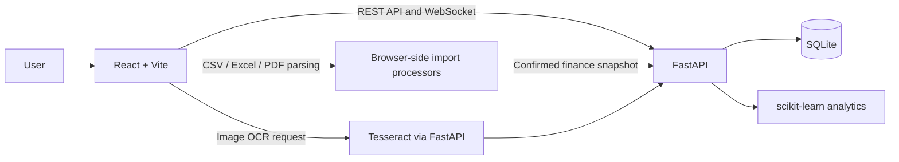

# FinSight AI

FinSight is a React/Vite finance dashboard with an optional FastAPI chat assistant. The assistant analyzes the finance store's transactions, budget plans, and savings goals; it can also create CSV, Excel, and PDF transaction reports.

## Run locally

1. In `backend`, create and activate a virtual environment, then install the backend dependencies:

   ```powershell
   cd backend
   py -m venv .venv
   .venv\Scripts\Activate.ps1
   python -m pip install -r requirements.txt
   Copy-Item .env.example .env
   ```

2. Start the API. The first run creates `backend/finsight.sqlite3` and seeds the demo account `demo@finsight.ai` / `demo1234`:

   ```powershell
   python -m uvicorn main:app --reload --port 8000
   ```

3. In a separate terminal at the project root, start the frontend:

   ```powershell
   npm install
   npm run dev
   ```

The Vite development server proxies `/api` and `/health` to the backend. The backend health endpoint is available at `http://localhost:8000/health`.

## Architecture



For a demo import, use the fictional [three-month sample statement](./demo-data/finsight-demo-transactions.csv). It includes salary credits, common expenses, and one unusually large electronics purchase for review. The rows are sample data only; categorization and anomaly indicators are suggestions and not bank-verified or fraud determinations.

## Installable app and report verification

FinSight includes a web app manifest, app icons, and a service worker that caches the app shell and static JS/CSS only; authenticated finance APIs and WebSockets are never cached. Install from the app navigation when your browser offers it (HTTPS is required in production; localhost is supported for development). Browser notifications are opt-in and mirror live budget/anomaly alerts while the signed-in app has an active WebSocket; background Web Push while the app is closed is not configured.

When a previously verified, unexpired session cannot reach the server, the app can restore that account's last cached finance snapshot from IndexedDB in read-only mode. Snapshots are kept per account on the current browser/device; offline changes are discarded rather than queued. The app revalidates the session and refreshes the snapshot after reconnecting, and a rejected session never falls back to cached data. Signing out clears the session but retains the per-account cache on that device; use **Delete my financial data** in Settings to remove it.

Generated PDF reports include a QR verification URL. Scan it, select the original PDF, and the browser calculates its SHA-256 digest locally; only the digest is sent to the verification endpoint. Verification confirms the exact generated file without uploading its contents. Set `FINSIGHT_PUBLIC_URL` to the public browser origin when reverse-proxy headers do not provide the right origin. Verification tokens and hashes are stored in the application's SQLite database.

## Data and limitations

Account registration and sign-in are handled by FastAPI. Passwords are stored as salted PBKDF2 hashes, bearer sessions are stored as hashes, and each user has a separate finance snapshot in SQLite. Existing browser-only sessions must sign in again after this upgrade. Set `FINSIGHT_DATABASE_PATH` to choose a different SQLite file location.

CSV, Excel, and PDF statement files are parsed in the browser; images selected for OCR are sent to the authenticated app backend and read with Tesseract. Confirmed transaction details and statement metadata are saved to the authenticated user's SQLite snapshot; transaction and budget-plan changes are synchronized to that snapshot. Merchant categorization uses deterministic user/system rules rather than a trained TF-IDF classifier. The command engine uses deterministic intent matching and verified local calculations; no LLM or external API key is required. Dashboard clients subscribe to `/ws/live-updates` and refresh their snapshot after a successful save.

Financial calculations are performed by local deterministic tools. Spending forecasts use a scikit-learn linear regression over monthly expense totals and report the model R² score. Financial education answers use the built-in keyword-retrieved knowledge base and show its source labels. The command experience is not financial, tax, or legal advice.

The dashboard's spending persona endpoint uses per-user monthly income and expense patterns with standardized, seeded three-cluster K-Means. It requires at least four eligible months, refreshes after finance updates, and reports a descriptive recurring pattern—not a prediction or a judgment. No other user's data is used.

Active savings goals also show a seeded 10,000-path Monte Carlo estimate, resampling positive net cash flow from up to 12 completed history months. It requires at least three observed months, caps the horizon at 12 months or the goal deadline, and assumes available surplus can be allocated to the selected goal. It does not model investments, returns, future bills, or income changes, so the percentage is an illustrative scenario—not a guarantee or investment forecast.

## Financial tools

The dashboard derives a double-entry ledger and trial balance from imported transactions, detects likely monthly subscriptions from at least three similar payments spaced 25–35 days apart, and includes a fixed-rate EMI simulator. The health gauge weights savings rate (40%), budget adherence (30%), and spending stability (30%); missing budget or history inputs receive neutral component scores. Forecast scenarios model food/grocery reductions and a monthly savings goal, and achievements are derived from transaction and budget history. Subscription matches are suggestions to review, not proof that a service is currently active. Budget alerts are generated when saved spending exceeds a monthly category allocation and are available from the notification bell.

The dashboard also includes a 13-week daily expense heatmap and a cash-flow pace warning when current month-to-date expenses project above recorded income. The warning is a simple run-rate estimate, not a balance forecast; future income and bills can change the outcome.

The dashboard's monthly cash-flow waterfall groups recorded current-month income and expenses by category and shows the resulting net cash flow; it does not represent a bank balance. The financial-year tax-preparation card exports spending totals for selected potentially relevant categories. It does not estimate deductions, eligibility, or tax savings because transaction categories alone cannot verify the applicable tax rules or supporting documents.

The authenticated app uses a per-user WebSocket for live snapshot updates and budget-alert toasts, reconnects with backoff, and displays connection status. The dashboard's live forecast endpoint fits the existing scikit-learn linear-regression model to the signed-in user's saved transactions; its R² is an in-sample fit statistic, not guaranteed predictive accuracy. The authenticated app bar also supports optimistic manual-expense entry with server persistence and rollback on failure. These expenses update the selected account balance when available and do not unlock the separate-statement import restriction.

New manual expenses are also checked against at least 10 prior same-category expenses using a deterministic scikit-learn Isolation Forest on log-scaled amounts. Unusual transactions create an idempotent, persisted alert and a per-user WebSocket toast. This is a review signal—not a fraud determination—and does not run until enough comparable history exists. Statement uploads already use per-user file hashes to prevent duplicate imports; authentication, finance changes, and imports are recorded in the activity log. No latency or forecast-accuracy guarantee is implied.

The signed-in app also shows a cross-page Copilot panel. It prioritizes uncertain transaction categorization, then statistical expense outliers, then savings-planner suggestions when the three most recent completed months are available. Each suggestion shows its evidence and links to the relevant review page; it does not change budgets or transactions automatically. The pipeline status reflects saved records and data sufficiency, not model accuracy or guaranteed outcomes.

The authenticated workspace includes a keyboard command palette (`Ctrl+K` / `Cmd+K`) for navigating pages and searching saved transactions. The login page links to a guided sample-data tour; that tour is illustrative and does not create or access a real account. Dark mode, route-level skeleton fallbacks, and a top-level error boundary are also available.

Settings can delete a user's saved finance snapshot, statement-upload fingerprints, alerts, and browser finance cache. The login account and security activity history are retained. Finance records are stored in the application's SQLite database. The deterministic command assistant does not send transaction data to an external LLM; image OCR requests are sent to the configured app backend.

The Activity History page shows recent application-recorded sign-ins, finance updates, manual expenses, exports, and deletions; it does not collect browser or IP details. Settings also supports an authenticated JSON export of the account profile, finance snapshot, and up to 1,000 recent activity events. Password hashes and active session tokens are excluded.

The authenticated app header can show quotes from Alpha Vantage. Configure `ALPHA_VANTAGE_API_KEY` and a comma-separated `FINSIGHT_MARKET_SYMBOLS` list in the backend environment; supported symbols and quote freshness depend on the provider plan. The backend caches results for up to four hours, and the UI labels the source and warns that quotes may be delayed. No market data is shown as real-time or fabricated when the feed is unconfigured or unavailable. Check Alpha Vantage usage terms and your plan's market-data entitlements before deployment.
